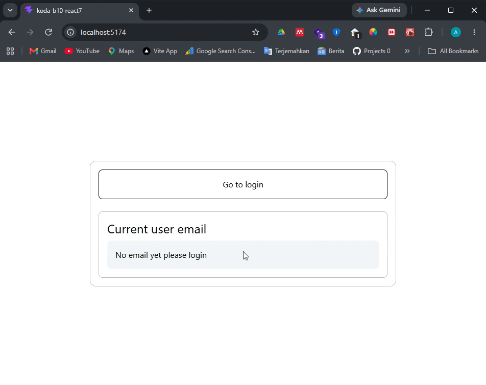

# React 7
on this repo i learn to use react context to handle state between pages on react router,
tha case i need to solve is to create two page home and login which the state came from login page
then the state need to access by homepage

### result

